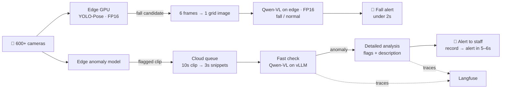

I take AI systems from prototype to production: vision-language models, real-time video pipelines, and the GPU serving and infrastructure underneath them.

**Now:** first ML engineer at an early-stage startup. I built and own a real-time safety-monitoring platform for **daycares and elder-care homes**, running on **600+ cameras** and **100+ edge devices**.

**Before:** Data Scientist at **HP**, where demand forecasting on Databricks/PySpark drove **$26M** in savings. M.S. in Analytics from Georgia State (4.0 GPA).

### What I built at work

| | |
|---|---|
| **95%+ precision / 92% recall** | in production, video + audio labels, tracked on live dashboards at every site |
| **~9,000 → 1–2** | video segments per camera per day, down to actionable alerts |
| **6–7s → <2s** | edge latency at 25 FPS (FP16, pose batching, frame sampling) |
| **~20s → 5–6s** | record-to-alert after moving cloud VLMs to vLLM with cross-camera batching |
| **6–7 hrs → <30 min** | site onboarding, with CI/CD and GitOps built from scratch |

### Field notes from production

- **An image VLM can see time if you tile it.** Six evenly spaced frames in one grid image gave Qwen-VL enough temporal context for falls, with no video model needed.
- **The fastest token is the one you don't generate.** Dropping the scene description from the alert path saved 1–2s per alert.
- **Cascades beat bigger models.** Cheap pose detection decides *when* to call the expensive VLM, and a fast check decides when to run the detailed one.
- **False alarms are a failure mode too.** If staff learn to ignore alerts, recall stops mattering. We tuned for both.
- **Not every optimization survives production.** FP32 → FP16 was a clear win. Quantizing further didn't hold up, so FP16 stayed.

### Building in public

| Project | What it is |
|---|---|
| [**CardPilot**](https://github.com/harshakvs/cardpilot) | Multi-agent credit-card optimizer: local ↔ cloud model router (Ollama ↔ Claude), pgvector RAG, tool use, Logfire tracing |
| [**my-portfolio**](https://github.com/harshakvs/my-portfolio) | My site, built with Astro: an in-browser resume chatbot, a gradient descent game, and write-ups |

### Stack

`PyTorch` `vLLM` `Hugging Face` `Qwen-VL` `YOLO` `OpenCV` `Langfuse` · `Kubernetes` `ArgoCD` `Helm` `GitLab CI` `Docker` · `AWS` `SageMaker` `Databricks` `PySpark` · `Python` `SQL`

### Find me

[Portfolio](https://harshakvs.github.io/my-portfolio/) · [LinkedIn](https://www.linkedin.com/in/sreeharsha-kvs) · [Resume](https://harshakvs.github.io/my-portfolio/Resume_Sreeharsha_Kotta.pdf) · sreeharshakotta@gmail.com

Open to **AI Engineer** and **ML Engineer** roles.
